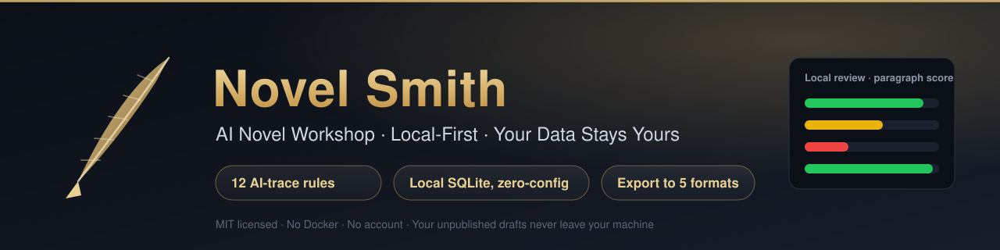

<!-- badges -->
[](LICENSE)
[](https://github.com/huanweide/novel-smith/actions/workflows/ci.yml)
[](https://github.com/huanweide/novel-smith/stargazers)
[](https://huanweide.github.io/novel-smith/)
[](https://github.com/huanweide/novel-smith/pulls)
<!-- /badges -->

<p align="center">
  
</p>

# 🔨 Novel Smith — AI Novel Workshop

> A **local-first** AI writing workshop for long-form web novels — characters, lore, outlines, and chapters, all on your own machine.
> A chat window is a talkative stranger; Novel Smith is the workbench that lives on your computer and remembers every detail of your world.

`TypeScript` · `Local-First` · `Tiered Memory Engine` · `Long-Form Web Novels` · `AI-trace Stripping (local review)` · `Data Stays on Your Machine · Zero Upload`

**One-line idea → explore the setting → auto-fill the tables → batch writing → local review → export the book**

[30-Second Demo](#30-second-demo) · [Screenshots](#screenshots) · [What It Does](#what-it-does) · [Features](#features) · [Desktop Build](#desktop-build) · [Quick Start](#quick-start) · [Command Reference](#command-reference) · [Architecture](#architecture) · [Add Your Own Rule](#add-your-own-rule) · [Roadmap](#roadmap) · [Contributing](#contributing) · [⭐ Star](#-star)

<p align="center">
  <a href="https://github.com/huanweide/novel-smith/releases/tag/v3.1.156"><b>💻 Download Desktop Build</b></a>
  &nbsp;·&nbsp;
  <a href="https://huanweide.github.io/novel-smith/"><b>▶ Live Demo</b></a>
</p>

> ⚡ **Don't want to install Node or touch the terminal?** Grab the desktop build and double-click to launch → [GitHub Releases · v3.1.156](https://github.com/huanweide/novel-smith/releases/tag/v3.1.156) (unsigned — if Windows SmartScreen blocks it, click "Run anyway").

**Current Version: v3.1.156** · Local SQLite, zero-config · 2163 tests · 140 API routes · 17 built-in presets · MIT License

---

## 30-Second Demo

Nothing to install, no API key. **Open the [AI-trace detector in the live demo](https://huanweide.github.io/novel-smith/)**, paste your own text, and get a report instantly.

Below is **real output** from this repo's rule engine (`src/core/humanize`) run on the AI-flavoured passage shown:

```
=== Local review report ===
AI-trace index  69 / 100          Level: noticeable

Raw statistics (explainable, not a magic number)
  Chars 181 · Sentences 6 · Avg sentence length 30.2 · Length std-dev 9.00
  Dash density 5.50 /1k chars · AI-vocab 27.60 /1k chars · Short-sentence ratio 0.0%

Grouped by rule
  ai-vocab          AI vocabulary          high    x5
  uniform-sentence  Over-uniform sentences medium  x1
  progressive-pair  "not only…but also"    medium  x1

Per-paragraph score
  [P0] ██████████ 100  3 hits
      · AI vocabulary(high)  "值得注意的…(It is worth noting that…)"
        Why:    Essay-style transition voice; nobody opens fiction this way.
        Fix:    Delete it and let the facts speak, or replace with a concrete action.
      · Over-uniform sentences(medium)
        Why:    Six sentences with a length std-dev of only 9.0 chars (avg 30.2).
        Fix:    Add a few short sentences (3-8 chars) to break the rhythm.
  [P1] ██████████ 100  2 hits
      · AI vocabulary(high)  "综上所述…(To sum up…)"
        Why:    Thesis voice; painfully out of place inside a novel.
        Fix:    Cut the sentence, or turn it into a character's judgement.
  [P2] ██████████ 100  2 hits
      · AI vocabulary(high)  "Sunlight filtered through the leaves…"
        Why:    A fixed template sentence AI uses for scene-setting.
        Fix:    Use a detail that actually serves the plot.
```

**This runs entirely in your browser** — no network, no upload, no model call, no cost. Your unpublished draft does not send a single byte off your machine, which is exactly what every cloud-based AI detector requires you to do.

> ⚠️ The rule engine can only help you **reduce machine-voice**. It does not guarantee passing any platform's AI-rate review; platform algorithms are private and constantly changing.

---

## Screenshots

Real screenshots of a running instance, not concept art. See the [live demo](https://huanweide.github.io/novel-smith/).

| Home — entry to your novel universe | Explore mode — build a world by talking |
|---|---|
|  |  |

Full loop, from one-line idea to AI-trace review:


---

## What It Does

Writing a long novel is not hard at the start — it is hard **in the middle**. By chapter 30 the protagonist reads like a different person, the hook you planted in chapter 12 is never mentioned again, and the AI's prose keeps thinning out.

Novel Smith hands that bookkeeping to the workbench so you keep the ideas and the sentences:

```
You: one-line idea — "in a cultivation world, a boy who cannot use any technique"

  Round 1  Explore mode      → 11 guided steps turn one line into a full world
  Round 2  Auto-archiving    → extract characters/places/factions → build cards + lore entries (15 categories)
  Round 3  Batch writing     → draft 1-10 chapter outlines first, then write prose in the background
  Round 4  Tiered memory     → last 4 chapters full + last 3 summarized + AI-compressed deep tier
  Round 5  Local review      → 12 rules scan paragraph by paragraph: green / yellow / red
  Round 6  One-click export  → TXT / Markdown / HTML / EPUB / DOCX
```

Chapter generation, book dissection, and character/lore management write into a local SQLite file, so they must run on your own machine (the live demo is a stateless cloud environment and cannot write local files). **Your drafts never leave your computer.**

### What works without an API key

| Feature | Needs a key |
|---|---|
| AI-trace detector, local review self-check | **No** — fully local rule engine |
| Word count, consistency checks, foreshadow tracking, relationship graph | No |
| Book dissection, export to Word / EPUB | No |
| Chapter generation, continuation, refinement, character chat | Yes (bring your own key) |

---

## Features

- **🔍 AI-trace rule engine (12 rules · all on by default)** — 9 paragraph-level + 3 document-level rules built purely on regex and statistics: zero LLM calls, zero network requests. Every hit returns "the snippet + why + how to fix", never a black-box score. See `src/core/humanize/rules.ts`.
- **🧠 Tiered memory engine (default)** — last 4 chapters full text + last 3 chapters summarized + AI-compressed deep tier, with S/A/B/C four-tier event decay (S is permanent, C is dropped after 5 chapters). Write 100 chapters without losing your cast, hooks, or setting. See `src/lib/memory-decay.ts`, `src/core/memory/`.
- **📋 Auto-fill pipeline (optional · off by default)** — after each chapter, extract structured tables → create character cards and lore entries → detect relationships → write back to the storyline. Authors who write by hand are never disturbed. See `src/core/assembly/engine.ts`.
- **📖 15-category deterministic lore classifier** — geography / faction / power system / fate system / physics / public system … 15 categories routed by weighted keywords, no fuzzy guessing. See `src/lib/world-category-classifier.ts`.
- **⚖️ Writing rule engine (specificity arbitration)** — rules carry 6 scope levels (global / volume / chapter range / event type / character scene / conditional); conflicts are resolved by priority vs. specificity with the winning reason spelled out. See `src/core/rules.ts`.
- **🧵 Frankenstein advance** — when the main storyline completes, a follow-on storyline is constructed automatically so the plot never runs dry; three pacing modes (fast / balanced / slow-burn). Entry point: `src/app/api/storylines/generate/route.ts`.
- **🔒 Network gate (local-only by default)** — every `/api/*` route sits behind access control that returns 403 to public sources; three trust modes (`trust-proxy-header` / `trust-cf-only` / `direct`) protect against accidental public deployment. See `src/lib/net-guard.ts`, `src/proxy.ts`.
- **💾 One local SQLite file** — `./data/novelforge.db`, zero-config; backing up is copying that file. No cloud service, no subscription, no account, no telemetry.
- **📦 Five export formats** — TXT / Markdown / HTML / EPUB / DOCX, packaged locally. See `src/core/docx.ts`, `src/core/epub.ts`.

---

<a id="desktop-build"></a>

## Desktop Build: Download & Run (no Node / no terminal)

> Don't want to install Node or touch the terminal? Grab the desktop build and double-click to launch.

- **Download**: [GitHub Releases · v3.1.156](https://github.com/huanweide/novel-smith/releases/tag/v3.1.156)
- Pick one of three packages:
  - `NovelSmith-3.1.156-setup.exe` (recommended) — NSIS installer; double-click to install, creates desktop / Start Menu shortcuts.
  - `NovelSmith-3.1.156-portable.exe` — single self-extracting file; runs from a USB drive or by double-click, no registry writes.
  - `NovelSmith-3.1.156.zip` — extract and run.
- **Blocked by Windows SmartScreen on first run?** That's the normal "unsigned" prompt, not a virus — click "Run anyway".
- **Seeing an "AI not configured" banner on first open?** Fill in your LLM Key in Settings (⚙️), or set `LLM_API_KEY` in `.env`. It doesn't block opening, nor local writing / book-dissection features that don't need AI.
- Data lives in a single local SQLite file; back it up by copying that file.


> The screenshot above is the real desktop home screen (rendered from the packaged Next server). The "AI not configured" banner only appears when no LLM key is set; fill it in Settings and it disappears. Local writing / book-dissection features that don't need AI work regardless.

## Quick Start

### The one-liner

```bash
npm run dev:db     # generate .env → create local tables → start
```

Open `http://localhost:3001`.

### Manual steps

```bash
git clone https://github.com/huanweide/novel-smith.git
cd novel-smith
cp .env.example .env          # defaults to local SQLite, nothing to edit
npm install                  # installs better-sqlite3 native module
npm run dev:db               # create tables + start
# open http://localhost:3001
```

```
$ npm run dev:db
✔ .env created (DATABASE_URL="file:./data/novelforge.db")
✔ Prisma schema synced to ./data/novelforge.db
✔ 17 built-in presets seeded
  ▲ Next.js 16.3.8
  - Local:   http://localhost:3001
  ✓ Ready in 2.4s
```

> Everything lives in `./data/novelforge.db` — a single local file, no external database service.
> Both `.env` and `/data/` are git-ignored and never pushed.

### Try without a key

```bash
npm run dev:db     # then open http://localhost:3001/detector
```

The detector gives you a total score plus four levels (clean / mild / noticeable / heavy), per-paragraph green-yellow-red bars, **why each hit looks machine-written and how to fix it**, and six explainable raw statistics.

### First-run: configure an LLM provider

1. Open **Settings** (top right) → pick a provider (**SiliconFlow** recommended: cheap, full DeepSeek lineup)
2. Paste your API key → **Test connection** → confirm success → **Save**

| Provider | Where to get a key | Price | Recommended model |
|---|---|---|---|
| SiliconFlow | [siliconflow.cn](https://siliconflow.cn) | ¥0.001~ /1K tokens | `deepseek-ai/DeepSeek-V4-Flash` |
| DeepSeek | [platform.deepseek.com](https://platform.deepseek.com) | ¥0.002~ /1K tokens | `deepseek-v4-flash` |
| OpenAI | [platform.openai.com](https://platform.openai.com) | $0.005~ /1K tokens | `gpt-4o` |
| Groq | [console.groq.com](https://console.groq.com) | free tier | `llama-3.3-70b-versatile` |
| Custom | any OpenAI-compatible endpoint | varies | varies |

Opening **Creative Workshop** for the first time seeds **17 built-in presets** — click "Apply" and start writing.

---

## Command Reference

| Command | Purpose |
|---|---|
| `npm run dev:db` | Create local DB + start dev server (recommended entry) |
| `npm run dev` | Dev server only (`localhost:3001`, Turbopack HMR) |
| `npm run build` | Production build (via `scripts/safe-build.mjs` guard) |
| `npm start` | Start production server |
| `npm test` | Run all vitest cases (2163) |
| `npm run test:coverage` | Tests with coverage |
| `npx tsc --noEmit` | TypeScript strict check (must be zero errors) |
| `npm run lint` | ESLint (**legacy debt, not a hard gate yet**) |
| `npm run lint:colors` | Color guard ARCH-7 (advisory, non-blocking) |
| `npm run doctor` | Environment self-check (deps / DB / config) |
| `npx prisma studio` | Database GUI (`localhost:5555`) |
| `npx prisma db push` | Sync Prisma schema → local SQLite |
| `npm run db:seed` | Seed built-in presets and sample data |

---

## Architecture

**In one sentence**: a single local SQLite file is the foundation; writing is a closed loop of *load context → generate → distill back → local review*. Setting and memory are not one-shot prompt text — they are structured archives that grow with every chapter and decay on a forgetting curve.

### Core concepts

| Concept | Meaning |
|---|---|
| **Tiered memory** | Three-tier context assembly (recent full text + summaries + compressed deep tier) that stops the "gets dumber the longer it runs" problem |
| **Event tiering (S/A/B/C)** | Four importance tiers with forgetting-curve decay: S permanent, A→B after 30 chapters, B→C after 15, C deleted after 5 |
| **Distillation** | After each chapter, structured facts are extracted and written back to character cards / lore / storyline so the setting grows on its own |
| **World Book** | 15-category lore entry store, injected before generation via trigger words |
| **Assembly (auto-fill)** | Turns AI-extracted tables into character cards and lore entries, and detects relationships |
| **Humanize (AI-trace stripping)** | 12 purely local rules, paragraph-level green/yellow/red scoring with "why + how to fix"; never rewrites your prose automatically |
| **Specificity** | Writing rules weighted by 6 scope levels; conflicts arbitrated by priority/specificity with a reason |

### The writing loop

```
        ┌──────────────────────────────────────────┐
        │                                          │
  one-line idea                                    │
        │                                          │
        ▼                                          │
   Explore mode (11 steps) ──► world / cast / factions
        │                                          │
        ▼                                          │
   Load context ◄──── tiered memory (recent + summary + deep tier)
        │         ◄──── World Book trigger injection
        │         ◄──── writing rules (specificity arbitration)
        ▼                                          │
   Outline ──► you confirm/edit ──► prose generation
        │                                          │
        ▼                                          │
   Distill back ──► cards / lore / storyline ──────┘
        │
        ▼
   Local review (12 rules, paragraph-level score)
        │
        ├── few hits ──► finalize ──► export TXT/MD/HTML/EPUB/DOCX
        └── many hits ──► back to the prose (you edit; the machine never writes for you)
```

### Core modules

| Module | File | Description |
|---|---|---|
| AI-trace rule set | `src/core/humanize/rules.ts` | 9 paragraph-level + 3 document-level rules, pure regex and statistics |
| Review scoring entry | `src/core/humanize/index.ts` | Aggregates 5 explainable stats → score + level + per-paragraph report |
| One-click fixes | `src/core/humanize/fixes.ts` | Deterministic fixes only, and **only applied when the author clicks** |
| Platform risk notes | `src/core/humanize/platform-risk.ts` | Risk notes by common platform conventions (does not predict algorithms) |
| Memory decay engine | `src/lib/memory-decay.ts` | S/A/B/C forgetting curve, independent of the foreshadowing system |
| Semantic recall | `src/core/memory/semantic-recall.ts` | Relevance recall over deep-tier events |
| Memory classifier | `src/lib/memory-classifier.ts` | Assigns an event to a memory tier and category |
| Distillation scorer | `src/core/distillation/scorer.ts` | Scores event importance into S/A/B/C |
| Context loader | `src/core/pipeline/context-loader.ts` | Assembles memory + lore + rules into one injection context |
| Outline / prose generation | `src/core/pipeline/generate-chapter-outline.ts`, `plan-chapter.ts` | Two-stage flow: outline first, prose second |
| Auto-fill pipeline | `src/core/assembly/engine.ts` | Tables → cards/lore → relationship detection → write-back |
| Lore classifier | `src/lib/world-category-classifier.ts` | 15 deterministic categories, labels derived from a single source of truth |
| Writing rule engine | `src/core/rules.ts` | 6 scope weights + conflict arbitration |
| Consistency check | `src/core/consistency/detectConflicts.ts` | Extract facts → detect conflicts → suggest fixes |
| Foreshadow tracking | `src/core/foreshadowing.ts` | Reminds you about hooks you planted and never paid off |
| Storyline advance | `src/core/storyline/generate.ts`, `execute-task.ts` | Seven-element main/side storylines + Frankenstein advance |
| Dissection & imitation | `src/core/dissect/engine.ts`, `imitation-engine.ts` | 15-dimension breakdown of other works + imitation writing |
| Network gate | `src/lib/net-guard.ts`, `src/proxy.ts` | `/api/*` access control with three trust modes |
| Export | `src/core/docx.ts`, `src/core/epub.ts` | Local DOCX / EPUB packaging |

Deeper explanations live in [ARCHITECTURE.md](ARCHITECTURE.md); per-module detail is in [`docs/architecture-reference/`](docs/architecture-reference/).

---

## Add Your Own Rule

The AI-trace engine is open — if you spot a machine-voice pattern in your own prose, add a rule (`src/core/humanize/rules.ts`):

```ts
// Example: catch the "two negations then a turn" AI signature
export function detectNegativeParallel(text: string, offset = 0): AiTraceHit[] {
  const hits: AiTraceHit[] = [];
  const re = /不是([^，。！？；\n]{1,20})[，、]不是([^，。！？；\n]{1,20})/g;
  let m: RegExpExecArray | null;
  while ((m = re.exec(text)) !== null) {
    hits.push({
      ruleId: "negative-parallel",
      ruleName: "否定式排比",
      severity: "high",
      excerpt: excerptAt(text, m.index, m[0].length),
      start: offset + m.index,
      end: offset + m.index + m[0].length,
      reason: "连续两次否定再转折，几乎成了 AI 写作的签名句式。",
      suggestion: "直接写「是什么」，别先绕两个「不是什么」。",
    });
  }
  return hits;
}

// Register it in the paragraph-level rule table and it takes effect
export const PARAGRAPH_RULES = [/* ...existing rules, */ detectNegativeParallel] as const;
```

`npm test` runs all 2163 cases to keep existing behaviour intact. Template-style extensions (outline / style card / character card) go straight into `templates/`.

---

## Roadmap

- [x] Single-file local SQLite architecture (zero-config, no Docker)
- [x] AI-trace rule engine + zero-friction online demo
- [x] Tiered memory engine + event-tier decay
- [x] Auto-fill pipeline + 15-category lore classifier
- [x] Two-stage batch writing (outline first, prose second)
- [x] Smart review + five export formats
- [x] `/api/*` access control with three trust modes
- [ ] Clear the ESLint legacy debt (1134 errors, mostly historical `no-explicit-any`) and promote it to a hard gate
- [ ] Preset community loop: import/export and sharing of built-in presets
- [ ] More built-in presets and genre starting points

Full schedule and delivery log: [ROADMAP.md](ROADMAP.md).

---

## Production Deploy

```bash
npm run build          # build for production
npm start              # start the production server
```

> **Read before any public deployment**: since v3.1.115 every `/api/*` route sits behind access control that **only accepts requests from the local machine or LAN** and returns 403 to public sources (allows `localhost` / `127.` / `10.` / `192.168.` / `172.16~31.` / `169.254.` / `::1` / `*.local`). This is a floor against accidental public deployment — **it is not an account system**.

> | `TRUSTED_PROXY_MODE` | What is trusted | Use when |
> | --- | --- | --- |
> | `trust-proxy-header` (default) | `CF-Connecting-IP` → `X-Forwarded-For` → `X-Real-IP` → `Host` | A reverse proxy really sits in front and you trust it to sanitize headers |
> | `trust-cf-only` | Only `CF-Connecting-IP` | **Recommended when exposed publicly** |
> | `direct` | No header at all; only the TCP peer address | No reverse proxy |

> When no trustworthy source can be determined, requests are **blocked**. For a temporary bypass use `ALLOW_UNKNOWN_SOURCE=true`; if you really must serve publicly, set `ALLOW_PUBLIC=true` **and** strongly also set `ALLOW_PUBLIC_TOKEN=<long random string>`. Full details in [SECURITY.md](SECURITY.md).

> ⚠️ This is a **network-range allowlist, not authentication**. It stops accidental public deployment, not other people on the same LAN. The real defence is binding to `127.0.0.1` plus a firewall.

---

## Contributing

A personal open-source project — all forms of participation are welcome. **Start with [CONTRIBUTING.md](CONTRIBUTING.md)**: it covers getting the app running, the directory layout, the three gates, and how to file a good issue.

1. **Star it** — the simplest, most useful support.
2. **Open an issue** — bug / feature / doc error, using the issue template (version + reproduction steps). For ideas, your work, or usage questions, use **Discussions**.
3. **Send a PR** — run `./scripts/git-snapshot.sh create "note"` first, then pass the three gates (`npx tsc --noEmit` / `npm test` / `npm run build`).

> Presets are the best community contribution — export your tuned style / world / character card as `.preset.json` and share it, or paste it into an issue; we are happy to make it a built-in preset.

Local development:

```bash
npm run dev            # dev server (localhost:3001)
npx tsc --noEmit       # type check (must be zero errors)
npm test               # 2163 cases
npx prisma studio      # database GUI (localhost:5555)
```

---

## Security Boundary

- **No upload** — prose, setting, and API keys all stay in your own SQLite file. No cloud service, no telemetry, no account system.
- **No ghostwriting** — the detector only flags traces and suggests fixes; even "one-click" fixes **only run when the author clicks**, never automatically.
- **No guarantee of passing review** — the rule engine reduces machine-voice; it does not predict any specific platform's algorithm.
- **Not an online service** — no account, no cloud sync, no "membership unlocks more chapters".
- `.env`, `/data/`, `*.db`, certificates and credential files are all git-ignored; CI includes a secret check and the code contains no hardcoded keys.

---

## What It Is Not

- **Not a fully automatic novel machine** — you approve every outline and every chapter. You are the author; it is the workbench.
- **Only the detector is key-free** — generation / continuation / refinement need your own key; detection, consistency checks, foreshadow tracking and export are always free and always offline.
- **Not a note-taking app with backlinks** — the World Book and character cards are structured archives built for writing long fiction (15 categories, auto-classification, auto-fill), not general notes.

---

## Sponsor

If Novel Smith actually helped you finish your story, buy me a cup of tea — entirely voluntary, changes nothing, carries no ads.

- **WeChat QR**: open the app at **Settings → Sponsor**
- **GitHub Sponsor**: the Sponsor button on the repo home page

> The QR code is just a static "transfer entry" image with no keys or credentials. The project collects no sponsorship amounts or messages on any backend.

---

## License

MIT License — see [LICENSE](LICENSE)

---

## ⭐ Star

🔨 If this workshop helped you get your story written, **drop a Star** so more long-form writers can find it.
[](https://github.com/huanweide/novel-smith/stargazers)

> Novel Smith · AI Novel Workshop · Local-First · Your Data Stays Yours

[中文 README →](README.md)
