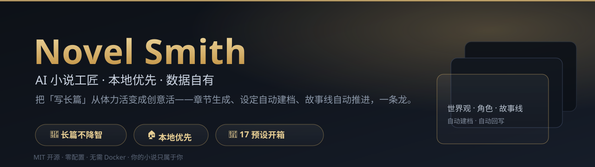

[](LICENSE)
[](https://github.com/huanweide/novel-smith/actions/workflows/ci.yml)
[](https://github.com/huanweide/novel-smith/stargazers)
[](https://huanweide.github.io/novel-smith/)
[](https://github.com/huanweide/novel-smith/pulls)



# Novel Smith — AI Novel Workshop

> A **local-first** AI writing workshop for long-form web novels — characters, lore, outlines, and chapters, all in one place.

`TypeScript` · `Local-First` · `Tiered Memory Engine` · `Long-Form Web Novels` · `Data Stays on Your Machine`

[⚡ Try in 30 seconds (no API key)](https://huanweide.github.io/novel-smith/) · [🖼 UI Preview](https://huanweide.github.io/novel-smith/) · [📦 Quick Start](#quick-start) · [中文 README](README.md) · [⭐ Star on GitHub](https://github.com/huanweide/novel-smith/stargazers)

**Current Version: v3.1.142** · Local SQLite, zero-config · 17 built-in presets · MIT License

**Try it in 30 seconds — no API key, nothing to install**


Open the **[AI-trace detector in the live demo](https://huanweide.github.io/novel-smith/)** and paste any text of your own. You get a real report instantly: which AI-writing patterns were hit, the exact snippets, why each one counts, and how to fix it.

This part **runs entirely in your browser** — no network calls, no upload, no API key. It is the project's core differentiator (a local rule engine) in action.

**Want the full feature set? Run it locally in two minutes**

Chapter generation, book dissection, character and lore management all write into a local SQLite file, so they need to run on your own machine. See [Quick Start](#quick-start). **Your drafts never leave your computer.**

**What works without an API key**

| Feature | Needs an API key |
|---|---|
| AI-trace detector, local review self-check | **No** — fully local rule engine |
| Word count, consistency checks, foreshadow tracking, relationship graph | No |
| Book dissection, export to Word / EPUB | No |
| Chapter generation, continuation, refinement, character chat | Yes (bring your own key) |

> The live demo runs in a stateless cloud environment (it cannot write local files), so only the parts that need no database are usable online. For everything else, run it locally.

---

## The Problem

Writing a long web novel is easy at Chapter 1, painful at Chapter 50:

- Characters multiply, and you forget who did what.
- Foreshadowing gets dropped; settings contradict each other.
- The AI "forgets" the story after 30 chapters and starts writing filler.
- You stare at a blank page, unsure where the plot goes next.
- Exporting to Word for your editor turns into a formatting nightmare.

Novel Smith automates the grunt work — so you can focus on the creative work.

---

## Screenshots

| Home — Projects & Presets | Explore — Chat-Based World Building |
|---|---|
|  |  |

---

## Why Novel Smith

| Pain Point | Traditional Tools | Novel Smith |
|---|---|---|
| Forgetting lore after 50 chapters | Manual spreadsheets | **Auto-fill tables**: extracts people, places, factions per chapter and auto-creates character cards & lorebook entries |
| Tangled character relationships | Draw graphs by hand | **Relationship graph**: draggable nodes, persisted layout, double-click to open cards |
| AI degrades over long stories | Dump full text into context | **Tiered memory engine**: full recent chapters + summaries + long-range compression |
| Writer's block | Stare at blank page | **Explore mode (11 steps)** + **stitch-monster plot continuation**: auto-spawns new main arcs when old ones end |
| Messy exports | Manual formatting | **One-click export** to TXT, Markdown, HTML, EPUB, DOCX |
| Cloud privacy concerns | Third-party SaaS | **Local SQLite**: your API keys and manuscripts never leave your machine |

---

## How Is This Different From Just Chatting With an AI?

You can already open a chat window and ask an AI to help you write. Here is the difference:

| | Chatting With an AI | Novel Smith |
|---|---|---|
| **Does it remember your lore?** | Forgets between windows; characters change personality session to session | Worldbook + character cards accumulate automatically; relevant lore is injected before every chapter |
| **Do characters drift?** | The protagonist in chapter 30 often feels like a different person | Auto-fill keeps character state current; contradictions are detected after each chapter |
| **Do planted foreshadows pay off?** | You keep your own notebook and hope | Foreshadow tracker reminds you what was planted but never resolved |
| **How do you handle the AI flavor?** | Ask the AI to "sound natural", then submit AI-flavored prose anyway | 12 local rules flag exactly which sentences read as AI-written, why, and how to fix them |
| **Where does the manuscript live?** | Scattered across dozens of chat logs | One project, one local database, one-click export to TXT / Markdown / EPUB / DOCX |
| **Who sees your text?** | Everything is uploaded to someone else's server | Manuscripts and API keys never leave your machine |

In one line: **a chat window is a talkative stranger; Novel Smith is a writing workstation that lives on your computer and remembers every setting you ever wrote.**

---

## Core Highlights

**12 local AI-trace rules** (9 paragraph-level + 3 whole-text) run entirely in your browser — no upload, no API cost, re-check as often as you like. Every hit tells you which sentence, why, and how to fix it. **15 lorebook categories** routed by a deterministic classifier. **2058 test cases** gate every change. **137 API routes**, all serving localhost only.

- **Lore pipeline (auto-fill, optional)** — After each chapter, extract structured facts and sync them to character cards, lorebook entries, and storyline beats.
- **Long-form memory** — Sliding window + long-range chapter compression + S/A/B event tiers keep the AI coherent across 100+ chapters.
- **Batch writing two-stage flow** — Generate 1–10 chapters: outlines first, edit them, then generate bodies in the background.
- **Stitch-monster continuation** — When the main arc ends, the system proposes the next arc; never run out of plot.
- **Character cards & relationship graph** — Full cards, AI fill/expand, auto-deduplication, and a draggable graph view.
- **Local-first** — Everything runs on `localhost` with a single SQLite file (`./data/novelforge.db`). No Docker, no cloud, no account.
- **15-category lorebook system** — Destiny, physics, public systems, etc., automatically routed by a deterministic classifier.
- **Book dissection** — 15-dimension analysis of other novels + style mimic engine.

---

## Quick Start

```bash
git clone https://github.com/huanweide/novel-smith.git
cd novel-smith
cp .env.example .env
npm install
npm run dev:db   # creates DB, starts server at http://localhost:3001
```

> Data lives in `./data/novelforge.db`. Back it up by copying the file.  
> `.env` is gitignored; your API keys stay local.

### Configure an LLM Provider

1. Open **Settings** (top-right).
2. Pick a provider (recommended: **SiliconFlow** for cheap DeepSeek models).
3. Paste your API key and click **Test Connection**.
4. Save.

---

## Tech Stack

- Next.js 16 (App Router) + React 19
- Tailwind CSS v4 (Void Glass design system)
- SQLite + better-sqlite3 + Prisma 7
- Next.js API Routes + SSE + background job table
- OpenAI-compatible multi-provider LLM client
- TypeScript strict mode (zero-error gate)

---

## Local Development

```bash
npm run dev         # localhost:3001, Turbopack HMR
npx tsc --noEmit    # type-check gate
npx prisma studio   # DB admin UI at localhost:5555
npx prisma db push  # sync schema
```

---

## Production Deploy Notes

```bash
npm run build
npm start
```

Since v3.1.115 every `/api/*` route sits behind a built-in access guard: **only requests from localhost or your LAN are accepted** — anything else gets a 403 (`localhost` / `127.` / `10.` / `192.168.` / `172.16~31.` / `169.254.` / `::1` / `*.local` are allowed). It is a safety net against accidental public deployment, not an account system.

**From v3.1.136 that guard is tiered by trust.** Previously the client IP was taken from headers such as `X-Forwarded-For`, which the client writes itself — so connecting directly to the port with a hand-made `X-Forwarded-For: 192.168.1.5` was enough to be treated as LAN and let through. Now the trusted source depends on how traffic actually reaches the app:

| `TRUSTED_PROXY_MODE` | What is trusted | When |
| --- | --- | --- |
| `trust-proxy-header` (default) | `CF-Connecting-IP` → `X-Forwarded-For` → `X-Real-IP` → `Host` | There is a reverse proxy you trust to sanitize headers. **Backwards compatible.** |
| `trust-cf-only` | Only `CF-Connecting-IP` (written by Cloudflare's edge, overriding forged values) | **Recommended when exposed publicly** |
| `direct` | No headers at all — only the TCP peer address | No proxy in front |

When no trustworthy source is available the request is **blocked** rather than allowed. `ALLOW_UNKNOWN_SOURCE=true` is the temporary escape hatch.

To serve publicly, `ALLOW_PUBLIC=true` is required, and `ALLOW_PUBLIC_TOKEN=<a long random string>` is **strongly recommended alongside it**. Be aware: `ALLOW_PUBLIC` on its own also opens access — that is legacy behaviour kept for backwards compatibility. The token's purpose is to raise the bar from "one mistyped variable" to "two mistakes before the app is exposed". See [SECURITY.md](SECURITY.md).

> This is an **IP allow-list, not authentication**. It protects against accidental public deployment, not against other people on the same LAN. Under `trust-cf-only`, an attacker who can reach the port directly around Cloudflare can still forge `CF-Connecting-IP` — **no code can detect that**. The real defence is binding to `127.0.0.1` plus a firewall, so the tunnel is the only way in.

---

## What It Is Not

Clear boundaries beat inflated claims:

- **Not an online service** — No account system, no cloud sync, no "subscribe to unlock more chapters". It is a local program that runs on your machine; your data is one SQLite file.
- **Not a fully automatic book machine** — It manages settings, memory, detection, and export, but you approve every outline and every chapter. You are the author; it is the workstation.
- **Only detection works without a Key** — AI generation, continuation, and polishing need your own API key. Detection, consistency checks, foreshadow tracking, and exports are local and free forever.
- **Not a note app with backlinks** — The worldbook and character cards are structured archives designed for long-form writing (15 categories, auto-classified, auto-filled), not a general-purpose note tool.
- **No guarantee of passing any platform's review** — The local detector is a rule-based scan of common AI-writing patterns that helps you catch issues early. It does not predict any specific platform's algorithm.

---

## Contributing

- ⭐ **Star** the repo if it saves you time.
- 🐛 **Open an Issue** for bugs or ideas.
- 🔧 **Send a PR** for fixes or features.
- 💬 **Share** presets exported as `.preset.json` — the best ones may become built-in examples.

---

## Sponsor

If Novel Smith helped you finish a story, you can buy the author a coffee — entirely optional, and it changes nothing about the features.

- **WeChat QR**: In the app, open "Settings → 赞助支持" and scan the author's own QR code
- **GitHub Sponsor**: the Sponsor button on this repo — the same QR code

> The QR image is just a payment entry point — no keys, no credentials, a plain static file that is safe to commit. The project collects no donation amounts or messages on any backend.

---

## License

MIT License — see [LICENSE](LICENSE)

---

> Novel Smith · AI Novel Workshop · Local-first · Your data stays yours
